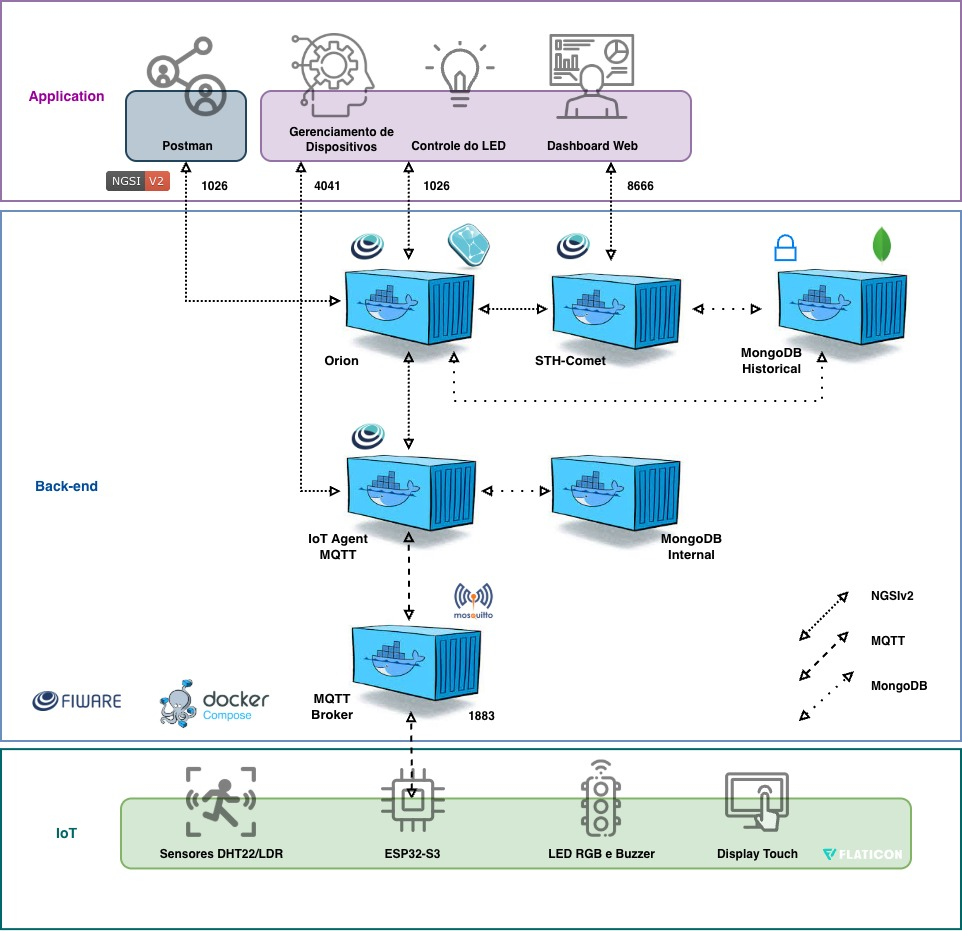

# Vinheria Agnello

Sistema de monitoramento ambiental para vinherias e adegas. Um dispositivo ESP32-S3 mede temperatura, umidade e luminosidade do ambiente onde os vinhos ficam armazenados, sinaliza anomalias no local com LED RGB, buzzer e display touch, e envia as leituras para a plataforma FIWARE. Um dashboard web mostra os dados em tempo quase real, guarda o histórico, permite controlar o LED e gerenciar os dispositivos IoT cadastrados.

Projeto desenvolvido para o CP5 da disciplina de Edge Computing.

## Sumário

1. [Visão geral](#visão-geral)
2. [Arquitetura em camadas](#arquitetura-em-camadas)
3. [Como funciona](#como-funciona)
4. [Hardware e pinagem](#hardware-e-pinagem)
5. [Faixas de alerta](#faixas-de-alerta)
6. [LED: modo automático e manual](#led-modo-automático-e-manual)
7. [Comunicação MQTT e modelo de dados FIWARE](#comunicação-mqtt-e-modelo-de-dados-fiware)
8. [Instalação](#instalação)
   - [Pré-requisitos (macOS, Linux e Windows)](#pré-requisitos)
   1. [FIWARE na AWS](#1-fiware-na-aws)
   2. [Provisionamento do dispositivo](#2-provisionamento-do-dispositivo)
   3. [Firmware com PlatformIO](#3-firmware-com-platformio)
   4. [Aplicação web local](#4-aplicação-web-local)
   5. [Deploy no Vercel](#5-deploy-no-vercel)
9. [Uso do dashboard](#uso-do-dashboard)
10. [API](#api)
11. [Estrutura de pastas](#estrutura-de-pastas)
12. [Testes e validação](#testes-e-validação)
13. [Segurança](#segurança)
14. [Solução de problemas](#solução-de-problemas)
15. [Histórico de revisões do firmware](#histórico-de-revisões-do-firmware)
16. [Créditos](#créditos)

## Visão geral

Vinhos precisam de condições estáveis: temperatura entre 10 e 16 °C, umidade entre 50 e 75 % e pouca luz. Variações fora dessas faixas aceleram o envelhecimento, ressecam rolhas e alteram aromas. O projeto resolve isso em duas frentes:

- **No local (edge):** o ESP32-S3 avalia as leituras sozinho, sem depender da nuvem, e avisa imediatamente com cor do LED, padrão sonoro do buzzer e telas no display touch.
- **Na nuvem:** as leituras e o estado do dispositivo vão para o FIWARE (IoT Agent, Orion Context Broker e STH-Comet), onde ficam disponíveis para o dashboard web, com histórico persistido em MongoDB.

Principais funcionalidades:

- Leitura de temperatura e umidade (DHT22) e luminosidade (LDR).
- Classificação de cada grandeza em normal, alerta ou crítico.
- LED RGB com modo automático (segue os alertas) e modo manual (cor escolhida remotamente).
- Buzzer com um padrão sonoro diferente para cada tipo de anomalia, com opção de silenciar.
- Display touch de 2,8" com menu principal, tela de configurações (tema claro/escuro, buzzer mudo) e tela de status do Wi-Fi e MQTT.
- Publicação via MQTT (UltraLight 2.0) para o FIWARE.
- Dashboard web com leituras atuais, gráficos de histórico, estado geral, controle do LED, cadastro e gestão de dispositivos IoT e tema claro/escuro.
- Deploy do front-end e da API no Vercel, acessando o FIWARE pelo IP público da instância AWS.

## Arquitetura em camadas



Legenda das ligações do diagrama:

| Linha | Protocolo |
| --- | --- |
| Pontilhada fina | NGSIv2 (HTTP) |
| Tracejada | MQTT |
| Pontilhada espaçada | MongoDB |

Ligações entre os componentes:

| Origem | Destino | Porta | Protocolo |
| --- | --- | --- | --- |
| Postman | Orion | 1026 | NGSIv2 |
| Gerenciamento de Dispositivos | IoT Agent MQTT | 4041 | NGSIv2 / API do IoT Agent |
| Controle do LED | Orion | 1026 | NGSIv2 |
| Dashboard Web | STH-Comet | 8666 | NGSIv2 (histórico) |
| Orion | STH-Comet | - | NGSIv2 (assinaturas) |
| Orion | MongoDB Historical | 27017 | MongoDB |
| STH-Comet | MongoDB Historical | 27017 | MongoDB |
| IoT Agent MQTT | Orion | - | NGSIv2 |
| IoT Agent MQTT | MongoDB Internal | 27017 | MongoDB |
| IoT Agent MQTT | MQTT Broker (Mosquitto) | 1883 | MQTT |
| ESP32-S3 | MQTT Broker (Mosquitto) | 1883 | MQTT (UltraLight 2.0) |

### Camada IoT

- **ESP32-S3-DevKitC-1** executando o firmware em `firmware/src/main.cpp` (framework Arduino, PlatformIO).
- **Sensores:** DHT22 (temperatura e umidade) e LDR (luminosidade).
- **Atuadores:** LED RGB e buzzer.
- **Interface local:** display TFT ILI9341 2,8" com touch resistivo XPT2046.
- Conecta-se ao Wi-Fi e ao broker MQTT, publica leituras e estado, e assina o tópico de comandos.

### Camada Back-end (FIWARE)

| Componente | Porta | Função |
| --- | --- | --- |
| MQTT Broker (Mosquitto) | 1883 | Recebe as publicações do ESP32 e entrega os comandos a ele |
| IoT Agent MQTT (UltraLight) | 4041 | Traduz UltraLight/MQTT para NGSIv2 e vice-versa; API de provisionamento |
| Orion Context Broker | 1026 | Guarda o estado atual das entidades (NGSIv2) e dispara assinaturas |
| STH-Comet | 8666 | Recebe notificações do Orion e armazena a série histórica |
| MongoDB Internal | 27017 | Banco do IoT Agent (dispositivos e service groups) |
| MongoDB Historical | 27017 | Banco do Orion e do STH-Comet (estado e série histórica) |

Todas as requisições ao FIWARE usam os headers `fiware-service: smart` e `fiware-servicepath: /`.

### Camada Application

- **Gerenciamento de Dispositivos:** página Dispositivos do dashboard, que cadastra, edita e exclui dispositivos no IoT Agent (porta 4041).
- **Controle do LED:** modo automático/manual e cores, enviados como comandos ao Orion (porta 1026).
- **Dashboard Web:** leituras atuais e gráficos do histórico do STH-Comet (porta 8666). Front-end React 19 + Vite + Tailwind CSS 4 + Recharts e API FastAPI (Python), publicados juntos no Vercel. O navegador só fala com a API do próprio projeto por HTTPS; a API consulta o FIWARE por HTTP no lado do servidor, o que evita o bloqueio de mixed content.
- **Postman:** coleção `FIWARE Descomplicado` em `web/src/api/`, usada para provisionar o FIWARE e testar requisições manualmente.

## Como funciona

Fluxo de dados, do sensor ao dashboard:

1. O ESP32 lê a luminosidade continuamente e o DHT22 a cada 2 s.
2. Cada leitura é classificada em normal, alerta ou crítico pelas faixas definidas no firmware.
3. Localmente, o LED (no modo automático) e o buzzer reagem ao pior nível encontrado, e o display mostra os valores em barras.
4. O ESP32 publica via MQTT no broker (porta 1883):
   - luminosidade a cada 1 s;
   - temperatura e umidade a cada 2 s;
   - estado (cor do LED, modo do LED e lista de alertas) a cada 1 s.
5. O IoT Agent recebe as mensagens UltraLight e atualiza a entidade `urn:ngsi-ld:Lamp:001` no Orion.
6. O Orion notifica o STH-Comet pelas assinaturas, e o STH-Comet grava o histórico no MongoDB.
7. O dashboard consulta a API (Vercel), que busca o estado atual no Orion a cada 5 s e o histórico no STH-Comet a cada 10 s.

Fluxo de comandos, do dashboard ao LED:

1. O usuário escolhe um modo ou cor no dashboard.
2. A API envia ao Orion um `PATCH /v2/entities/urn:ngsi-ld:Lamp:001/attrs` com o comando.
3. O Orion repassa ao IoT Agent (registro de comandos), que publica em `/TEF/lamp001/cmd` a mensagem `lamp001@<comando>|`.
4. O ESP32 recebe, aplica o comando e confirma o novo estado na próxima publicação de `state`/`ledMode`.

## Hardware e pinagem

### Lista de componentes

| Componente | Observação |
| --- | --- |
| ESP32-S3-DevKitC-1 | Placa principal |
| DHT22 | Temperatura e umidade |
| LDR (ou potenciômetro na simulação) | Luminosidade, em divisor de tensão |
| LED RGB (KY-016) | Sinalização |
| Buzzer | Alertas sonoros |
| Display TFT 2,8" ILI9341 320x240 com touch XPT2046 | Interface local |

### Pinagem (ESP32-S3)

| Componente | Sinal | GPIO |
| --- | --- | --- |
| LED RGB | R / G / B | 10 / 11 / 12 |
| Buzzer | Sinal | 4 |
| DHT22 | Dados | 15 |
| LDR | Saída analógica (ADC1_CH0) | 1 |
| Display ILI9341 | SCK | 13 |
| Display ILI9341 | MOSI (SDI) | 14 |
| Display ILI9341 | CS | 5 |
| Display ILI9341 | DC | 6 |
| Display ILI9341 | RST | 7 |
| Display ILI9341 | LED (backlight) | 18 |
| Display ILI9341 | MISO (SDO) | não ligado (o código reserva o GPIO 47) |
| Touch XPT2046 | T_CLK | 39 |
| Touch XPT2046 | T_DO | 40 |
| Touch XPT2046 | T_DIN | 41 |
| Touch XPT2046 | T_CS | 21 |
| Touch XPT2046 | T_IRQ | 17 |

Observações importantes:

- **Alimente o display com 3V3.** Em 5 V a tela pisca em branco.
- O pino SDO/MISO do display fica desligado, mas o `SPI.begin` precisa de um pino MISO livre (47). Com `-1`, o core do ESP32-S3 usa o GPIO 13 como padrão, o mesmo do SCK, e a tela fica branca.
- O touch é lido por SPI em software (bit-bang), separado do barramento do display.
- Calibração do touch (rotação 3 do display, os dois eixos invertidos): `TOUCH_X_MIN 3800`, `TOUCH_X_MAX 300`, `TOUCH_Y_MIN 3800`, `TOUCH_Y_MAX 300`.

Pinos a evitar no ESP32-S3:

- 19 e 20 (USB nativo);
- 26 a 32 (flash/PSRAM) e 35 a 37 (PSRAM octal em algumas versões);
- 0, 3, 45 e 46 (strapping);
- 43 e 44 (UART0, usada pelo monitor serial).

Leituras analógicas devem usar apenas os GPIOs 1 a 10 (ADC1), porque o ADC2 não funciona com o Wi-Fi ligado.

### Telas do display

- **Conexão:** mensagens de "Conectando Wi-Fi", "Wi-Fi conectado", "Conectando MQTT" e "MQTT conectado" na partida.
- **Menu principal:** temperatura, luminosidade e umidade em barras, atualizadas em tempo real, com ícones animados (ícones gerados no Lopaka, em `firmware/include/`). A engrenagem no canto superior direito abre as configurações.
- **Configurações:** tema claro/escuro e buzzer mudo, salvos na memória flash (Preferences), e acesso à tela de Wi-Fi/MQTT.
- **Wi-Fi/MQTT:** status das conexões ao vivo. A seta do canto volta para as configurações.

A reconexão de Wi-Fi (a cada 10 s) e de MQTT (a cada 5 s) não trava o loop.

## Faixas de alerta

As faixas estão nas constantes `FAIXA_TEMP`, `FAIXA_UMID` e `FAIXA_LUZ` em `firmware/src/main.cpp` e espelhadas no front-end em `web/src/config/sensores.js`.

| Grandeza | Normal | Alerta | Crítico |
| --- | --- | --- | --- |
| Temperatura | 10 a 16 °C | 8 a 10 °C ou 16 a 18 °C | abaixo de 8 °C ou acima de 18 °C |
| Umidade | 50 a 75 % | 40 a 50 % ou 75 a 85 % | abaixo de 40 % ou acima de 85 % |
| Luminosidade | até 30 % | 30 a 60 % | acima de 60 % |

A luminosidade não tem limite inferior: escuro é sempre normal.

### Atributo `alert`

O ESP32 publica no atributo `alert` a palavra `ok` quando tudo está normal, ou a lista das anomalias no formato `<grandeza>:<nivel>`, **separadas por vírgula**:

```
ok
temp:critico
temp:critico,luz:alerta
umid:alerta,luz:critico
```

Nomes usados: `temp`, `umid` e `luz`; níveis `alerta` e `critico`.

A vírgula é usada a partir da Rev34 do firmware. Antes, o separador era `;`, que é um caractere proibido no Orion: com duas ou mais anomalias, o Orion recusava a atualização inteira de `state`, `ledMode` e `alert`. O parser do dashboard aceita os dois separadores, para compatibilidade com dados antigos.

### Buzzer

Cada anomalia tem um padrão sonoro próprio, tocado sem bloquear o loop:

| Anomalia | Padrão |
| --- | --- |
| Temperatura | 2 bipes agudos curtos |
| Umidade | 1 bipe grave longo |
| Luminosidade | 3 bipes rápidos |

Com várias anomalias ao mesmo tempo, os padrões se alternam. O buzzer toca em qualquer modo do LED e pode ser silenciado na tela de configurações do display.

## LED: modo automático e manual

O modo do LED é publicado no atributo `ledMode` e alterado pelos comandos `auto` e `manual`.

### Modo automático (`auto`, padrão)

| Situação | LED |
| --- | --- |
| Tudo normal | verde fixo |
| Pelo menos um alerta | amarelo piscando |
| Pelo menos um crítico | vermelho piscando |

O LED pisca até o valor voltar ao normal.

### Modo manual (`manual`)

O usuário escolhe a cor com os comandos:

| Comando | Cor |
| --- | --- |
| `red` | vermelho |
| `green` | verde |
| `blue` | azul |
| `yellow` | amarelo |
| `cyan` | ciano |
| `magenta` | magenta |
| `white` | branco |
| `off` | desligado |

No modo automático os comandos de cor são ignorados pelo firmware. Para trocar a cor é preciso enviar `manual` antes. No dashboard, os botões de cor ficam habilitados quando `ledMode` informa `manual` ou depois que o Orion aceita o comando `manual` (o painel mostra "Manual solicitado" até a telemetria confirmar).

## Comunicação MQTT e modelo de dados FIWARE

### Identificação

| Item | Valor |
| --- | --- |
| Device ID | `lamp001` |
| Client ID MQTT | `fiware_001` |
| API key (service group) | `TEF` |
| Protocolo | UltraLight 2.0 sobre MQTT |
| Entidade Orion | `urn:ngsi-ld:Lamp:001` |
| Tipo da entidade | `Lamp` |

### Tópicos

| Direção | Tópico | Conteúdo | Frequência |
| --- | --- | --- | --- |
| ESP32 publica | `/TEF/lamp001/attrs` | `s|<cor>|m|<auto ou manual>|a|<alerta>` | 1 s |
| ESP32 publica | `/TEF/lamp001/attrs/l` | luminosidade (0 a 100) | 1 s |
| ESP32 publica | `/TEF/lamp001/attrs/t` | temperatura (°C) | 2 s |
| ESP32 publica | `/TEF/lamp001/attrs/h` | umidade (%) | 2 s |
| ESP32 assina | `/TEF/lamp001/cmd` | `lamp001@<comando>|` | sob demanda |

Exemplo de publicação de estado:

```
s|yellow|m|auto|a|temp:alerta,luz:alerta
```

### Atributos da entidade

| object_id | Atributo | Tipo | Descrição |
| --- | --- | --- | --- |
| `s` | `state` | Text | cor atual do LED |
| `m` | `ledMode` | Text | `auto` ou `manual` |
| `a` | `alert` | Text | `ok` ou lista de anomalias |
| `l` | `luminosity` | Integer | luminosidade em % |
| `t` | `temperature` | Float | temperatura em °C |
| `h` | `humidity` | Float | umidade relativa em % |

Comandos registrados: `red`, `green`, `blue`, `yellow`, `cyan`, `magenta`, `white`, `off`, `auto` e `manual`.

Para enviar um comando direto ao Orion:

macOS e Linux:

```sh
curl -X PATCH "http://<IP_EC2>:1026/v2/entities/urn:ngsi-ld:Lamp:001/attrs" \
  -H "Content-Type: application/json" \
  -H "fiware-service: smart" \
  -H "fiware-servicepath: /" \
  -d '{"manual": {"type": "command", "value": ""}}'
```

Windows (PowerShell):

```powershell
Invoke-RestMethod -Method Patch `
  -Uri "http://<IP_EC2>:1026/v2/entities/urn:ngsi-ld:Lamp:001/attrs" `
  -Headers @{ "fiware-service" = "smart"; "fiware-servicepath" = "/" } `
  -ContentType "application/json" `
  -Body '{"manual": {"type": "command", "value": ""}}'
```

## Instalação

As instruções abaixo valem para **macOS**, **Linux** e **Windows**. Quando um passo muda de um sistema para outro, há um bloco para cada um.

Convenções usadas nos exemplos:

- macOS e Linux: comandos no Terminal (bash ou zsh).
- Windows: comandos no **PowerShell** (Windows 10 ou 11). No PowerShell, use `curl.exe` (e não `curl`, que é um apelido para outro comando) e o acento grave `` ` `` para quebrar linhas.

### Pré-requisitos

| Ferramenta | Uso | Versão |
| --- | --- | --- |
| Conta AWS (ou AWS Academy Learner Lab) | Servidor FIWARE | - |
| Git | Clonar o repositório | qualquer recente |
| Node.js | Front-end | 22.12 ou superior |
| Python | API | 3.12 ou superior |
| VS Code com a extensão PlatformIO IDE | Compilar e gravar o firmware | - |
| Driver USB-serial da placa (CP210x ou CH340) | Gravar o ESP32 | - |
| Postman | Provisionamento do FIWARE | - |
| Cliente SSH | Acessar a EC2 | já vem nos três sistemas |
| Conta Vercel (plano Hobby atende) | Deploy | - |

#### macOS

Com o [Homebrew](https://brew.sh) instalado:

```sh
brew install git node@22 python@3.12
brew install --cask visual-studio-code postman
```

Se o Homebrew avisar que `node@22` ou `python@3.12` não estão no PATH, siga a instrução que ele mostra no final (normalmente uma linha `echo 'export PATH=...' >> ~/.zshrc`) e abra um novo Terminal.

Alternativa sem Homebrew: instaladores de [nodejs.org](https://nodejs.org), [python.org](https://www.python.org/downloads/), [git-scm.com](https://git-scm.com), [code.visualstudio.com](https://code.visualstudio.com) e [postman.com](https://www.postman.com/downloads/).

Driver USB: placas com chip CH340 podem precisar do driver do fabricante (WCH). Placas com CP210x e a porta USB nativa do ESP32-S3 funcionam sem driver nas versões atuais do macOS.

#### Linux

Debian e Ubuntu:

```sh
sudo apt update
sudo apt install -y git curl python3 python3-venv python3-pip
curl -fsSL https://deb.nodesource.com/setup_22.x | sudo -E bash -
sudo apt install -y nodejs
```

Fedora:

```sh
sudo dnf install -y git curl nodejs python3 python3-pip
```

Confira se o Node é 22.12 ou superior (`node -v`) e se o Python é 3.12 ou superior (`python3 --version`). Se a distribuição trouxer versões antigas, use o [nvm](https://github.com/nvm-sh/nvm) para o Node e o `pyenv` ou o pacote `python3.12` para o Python.

VS Code: pacote `.deb` ou `.rpm` em [code.visualstudio.com](https://code.visualstudio.com). Postman: [postman.com/downloads](https://www.postman.com/downloads/) ou `flatpak install flathub com.getpostman.Postman`.

Acesso à porta serial (necessário para gravar o ESP32 sem `sudo`):

```sh
# Debian/Ubuntu: grupo dialout. Fedora/Arch: grupo dialout ou uucp, conforme a distribuição
sudo usermod -aG dialout $USER

# Regras udev do PlatformIO
curl -fsSL https://raw.githubusercontent.com/platformio/platformio-core/develop/platformio/assets/system/99-platformio-udev.rules | sudo tee /etc/udev/rules.d/99-platformio-udev.rules
sudo udevadm control --reload-rules
sudo udevadm trigger
```

Saia da sessão e entre de novo (ou reinicie) para o novo grupo valer. No Ubuntu, se a placa conectar e desconectar sozinha, remova o pacote `brltty` (`sudo apt remove brltty`), que captura adaptadores seriais.

#### Windows

Com o `winget` (já vem no Windows 10 e 11), no PowerShell:

```powershell
winget install --id Git.Git -e
winget install --id OpenJS.NodeJS.LTS -e
winget install --id Python.Python.3.12 -e
winget install --id Microsoft.VisualStudioCode -e
winget install --id Postman.Postman -e
```

Feche e abra o PowerShell depois da instalação. Confira com `node -v`, `py -3.12 --version` e `git --version`.

Se instalar o Python pelo site [python.org](https://www.python.org/downloads/), marque **Add python.exe to PATH** no instalador.

Se o PowerShell bloquear scripts do npm com a mensagem "a execução de scripts foi desabilitada neste sistema", rode uma vez:

```powershell
Set-ExecutionPolicy -Scope CurrentUser RemoteSigned
```

Driver USB: instale o driver do chip USB-serial da placa, [CP210x (Silicon Labs)](https://www.silabs.com/developers/usb-to-uart-bridge-vcp-drivers) ou CH340 (WCH). Depois de conectar a placa, ela aparece no **Gerenciador de Dispositivos**, em "Portas (COM e LPT)", como `COM3`, `COM4` etc.

#### Extensão PlatformIO (todos os sistemas)

No VS Code, abra a aba Extensões, procure **PlatformIO IDE** e instale. Na primeira abertura a extensão baixa as ferramentas sozinha (precisa de internet e pode levar alguns minutos). Ela usa um Python próprio, independente do Python do sistema.

Para usar o comando `pio` no terminal fora do VS Code:

- macOS e Linux: adicione `~/.platformio/penv/bin` ao PATH, ou use o terminal integrado do VS Code (botão "PlatformIO: New Terminal").
- Windows: adicione `%USERPROFILE%\.platformio\penv\Scripts` ao PATH, ou use o terminal do PlatformIO dentro do VS Code.

#### Clonar o repositório

Igual nos três sistemas:

```sh
git clone https://github.com/GianAntonicci/Vinheria-Agnello-Full.git
cd Vinheria-Agnello-Full
```

### 1. FIWARE na AWS

1. Crie uma instância EC2 Ubuntu (t2.medium ou superior recomendado, pelo menos 20 GB de disco) e baixe o par de chaves (`.pem`).
2. Associe um **Elastic IP** à instância, para o IP público não mudar a cada reinício do laboratório.
3. No **Security Group**, libere as portas de entrada TCP:

   | Porta | Serviço | Quem acessa |
   | --- | --- | --- |
   | 22 | SSH | administrador |
   | 1883 | MQTT Broker | ESP32 |
   | 4041 | IoT Agent | Postman e API do dashboard |
   | 1026 | Orion | Postman e API do dashboard |
   | 8666 | STH-Comet | Postman e API do dashboard |

   A porta 27017 (MongoDB) é usada apenas entre os containers e **não** deve ser aberta para a internet.

4. Conecte-se por SSH. O usuário padrão da imagem Ubuntu é `ubuntu`.

   macOS e Linux:

   ```sh
   chmod 400 ~/Downloads/labsuser.pem
   ssh -i ~/Downloads/labsuser.pem ubuntu@<IP_EC2>
   ```

   Windows (PowerShell; o OpenSSH já vem instalado no Windows 10 e 11):

   ```powershell
   icacls "$env:USERPROFILE\Downloads\labsuser.pem" /inheritance:r /grant:r "$($env:USERNAME):R"
   ssh -i "$env:USERPROFILE\Downloads\labsuser.pem" ubuntu@<IP_EC2>
   ```

   O comando `icacls` faz no Windows o mesmo que o `chmod 400`: sem ele o SSH recusa a chave com o erro "UNPROTECTED PRIVATE KEY FILE". Também é possível usar o PuTTY, convertendo o `.pem` para `.ppk` no PuTTYgen.

5. Já dentro da EC2 (os comandos daqui em diante rodam no Ubuntu da AWS, qualquer que seja o seu sistema), instale o Docker:

   ```sh
   sudo apt update
   sudo apt install -y docker.io docker-compose-v2 git
   sudo usermod -aG docker $USER
   ```

   Saia (`exit`) e entre de novo na sessão SSH para o grupo valer.

6. Suba a stack do FIWARE Descomplicado (MQTT Broker, IoT Agent, Orion, STH-Comet e MongoDB):

   ```sh
   git clone https://github.com/fabiocabrini/fiware
   cd fiware
   docker compose up -d
   docker ps
   ```

7. No seu computador, confira se os serviços respondem.

   macOS e Linux:

   ```sh
   curl http://<IP_EC2>:4041/iot/about
   curl http://<IP_EC2>:1026/version
   curl http://<IP_EC2>:8666/version
   ```

   Windows (PowerShell):

   ```powershell
   curl.exe http://<IP_EC2>:4041/iot/about
   curl.exe http://<IP_EC2>:1026/version
   curl.exe http://<IP_EC2>:8666/version
   ```

   Também dá para abrir esses endereços direto no navegador.

No AWS Academy Learner Lab a instância desliga quando a sessão do laboratório termina. Ao iniciar o laboratório de novo, ligue a instância e confira se os containers voltaram com `docker ps` (se não, rode `docker compose up -d` na pasta `fiware`).

### 2. Provisionamento do dispositivo

O Postman funciona igual nos três sistemas. Importe a coleção `web/src/api/FIWARE Descomplicado.postman_collection.json` (File > Import) e preencha a variável `url` da coleção com o IP público da EC2. Execute, em ordem, na pasta **IOT Agent MQTT**:

1. `1.1 Health Check`
2. `2. Provisioning a Service Group for MQTT` (cria o grupo com a apikey `TEF`)
3. `3. Provisioning a Smart Lamp` (cria o `lamp001` com os atributos `s`, `m`, `a`, `l`, `t`, `h` e os comandos)
4. `4. Registering Smart Lamp Commands`

Para o histórico, crie as assinaturas do STH-Comet na pasta **STH-Comet** (`2. Subscribe Luminosity`). Repita a assinatura trocando o atributo para `temperature` e `humidity`, ou cadastre o dispositivo pelo dashboard com a opção de assinaturas marcada, que cria as três.

Sempre que mudar comandos ou atributos, refaça o provisionamento: apague o dispositivo (`11. Delete Smart Lamp in IoT Agent` e `12. Delete Smart Lamp in Orion`) e rode novamente as requisições 3 e 4.

O dispositivo também pode ser cadastrado pela página **Dispositivos** do dashboard (o service group `TEF` precisa existir antes).

### 3. Firmware com PlatformIO

1. No VS Code, abra a pasta `firmware/` (File > Open Folder) ou adicione-a a um workspace. O PlatformIO só reconhece o projeto se o `platformio.ini` estiver na raiz da pasta aberta.
2. A rede Wi-Fi e o broker MQTT não ficam no código: são cadastrados pelo portal de configuração do próprio ESP32 e salvos na memória flash. Depois de gravar o firmware (passo 5):
   1. Ligue a placa. Sem configuração salva (ou se a rede salva não conectar em 20 s), o display mostra a tela "Configurar rede".
   2. No celular, conecte na rede `Vinheria-XXXX` (os 4 últimos dígitos do MAC aparecem no display) com a senha `vinheria123`.
   3. A página de configuração abre sozinha; se não abrir, acesse `http://192.168.4.1` no navegador.
   4. Escolha a rede na lista (ou digite o nome), digite a senha, informe o IP público da EC2 no campo do broker com a porta `1883` e toque em "Salvar e conectar". A placa reinicia e conecta com os novos dados.

   O ESP32 só conecta em redes de 2,4 GHz. Para reconfigurar depois, toque na engrenagem do menu, depois na seta de WiFi/MQTT e em "Configurar": o portal abre de novo, mesmo com a placa conectada. Na página, "Apagar configuração" remove a rede e o broker salvos (tema e buzzer são mantidos).

3. Confira se os headers dos ícones (gerados no Lopaka) estão em `firmware/include/`.
4. Conecte a placa pela porta **UART** (a mesma usada para gravar; em placas com dois conectores USB, normalmente a marcada como "UART" ou "COM"). O `platformio.ini` define `-DARDUINO_USB_CDC_ON_BOOT=0`, então o monitor serial usa essa porta.
5. Compile, grave e abra o monitor pelos botões da barra inferior do VS Code (Build, Upload e Serial Monitor) ou pelo terminal:

   ```sh
   pio run
   pio run -t upload
   pio device monitor
   ```

   O monitor serial roda a 115200 baud. O PlatformIO detecta a porta sozinho; se houver mais de uma, informe com `--upload-port` e `--port`.

Nome da porta serial em cada sistema:

| Sistema | Como a placa aparece | Como listar |
| --- | --- | --- |
| macOS | `/dev/cu.usbserial-XXXX`, `/dev/cu.SLAB_USBtoUART` ou `/dev/cu.wchusbserialXXXX` | `ls /dev/cu.*` ou `pio device list` |
| Linux | `/dev/ttyUSB0` ou `/dev/ttyACM0` | `ls /dev/ttyUSB* /dev/ttyACM*` ou `pio device list` |
| Windows | `COM3`, `COM4` etc. | Gerenciador de Dispositivos ou `pio device list` |

Exemplo forçando a porta:

```sh
# macOS
pio run -t upload --upload-port /dev/cu.usbserial-0001
# Linux
pio run -t upload --upload-port /dev/ttyUSB0
# Windows
pio run -t upload --upload-port COM3
```

Se a gravação não iniciar ("Failed to connect to ESP32"), segure o botão **BOOT** da placa, clique em Upload e solte quando aparecer "Connecting...".

Bibliotecas instaladas automaticamente pelo PlatformIO (`lib_deps`): ArduinoJson, DHT sensor library, Adafruit Unified Sensor, PubSubClient, Adafruit GFX, Adafruit ILI9341 e RTClib.

Convenções do firmware:

- Todo o código fica em `firmware/src/main.cpp`.
- Compila com `-std=gnu++11`: não use recursos de C++14 ou mais novos.
- O loop não usa `delay()` longo; LED, buzzer e publicações são controlados por `millis()`.
- Cada alteração relevante ganha uma linha no histórico de revisões no topo do arquivo (`//RevN: DD-MM-AAAA ...` e `//Autor RevN: ...`).
- Comentários e mensagens de Serial em português.

### 4. Aplicação web local

Os comandos são os mesmos nos três sistemas. A partir da raiz do repositório:

```sh
cd web
npm install
npm run dev
```

Não é preciso criar nem ativar ambiente Python manualmente. O `npm run dev` sobe ao mesmo tempo o Vite (front-end) e o Uvicorn (API FastAPI). Na primeira execução ele cria o ambiente Python em `web/.venv` e instala `requirements-dev.txt` (que inclui `requirements.txt`); isso precisa de internet. Nas próximas execuções só reinstala se algum desses arquivos mudar.

Abra `http://localhost:5173`.

Como o inicializador (`web/scripts/dev-api.mjs`) encontra o Python em cada sistema:

| Sistema | Procura o Python em | Python do ambiente |
| --- | --- | --- |
| macOS | `python3`, `python` | `web/.venv/bin/python` |
| Linux | `python3`, `python` | `web/.venv/bin/python` |
| Windows | `py -3.12`, `py -3`, `python3`, `python` | `web\.venv\Scripts\python.exe` |

No Windows, o Ctrl+C encerra também o processo do Uvicorn (o inicializador usa `taskkill` para isso).

Outros comandos:

| Comando | Função |
| --- | --- |
| `npm run setup:api` | Só prepara o Python, sem subir servidores |
| `npm run dev:web` | Só o Vite (use junto com o próximo, em outro terminal) |
| `npm run dev:api` | Só a API em `http://127.0.0.1:8000` |
| `npm run build` | Gera o build de produção em `web/dist` |
| `npm run preview` | Serve o build localmente |
| `npm run lint` | Executa o ESLint |

O Vite encaminha `/api` para `http://127.0.0.1:8000`, sem necessidade de CORS. Documentação interativa da API: `http://localhost:5173/api/docs`.

Para recriar o ambiente Python do zero (por exemplo, depois de atualizar o Python):

```sh
# macOS e Linux
rm -rf web/.venv
```

```powershell
# Windows (PowerShell)
Remove-Item -Recurse -Force web\.venv
```

### 5. Deploy no Vercel

O deploy é feito pelo navegador e não depende do sistema operacional. Front-end e API ficam num único projeto Vercel, no mesmo domínio.

1. No Vercel, importe o repositório `Vinheria-Agnello-Full`.
2. Configure:

   | Opção | Valor |
   | --- | --- |
   | Root Directory | `web` |
   | Framework Preset | Vite |
   | Build Command | `npm run build` |
   | Output Directory | `dist` |
   | Install Command | `npm ci` |

3. Não defina `VITE_API_URL`. A URL da API é relativa (`/api`).
4. Faça o deploy.

Como funciona no Vercel:

- `web/vercel.json` encaminha `/api/*` para a função Python `web/api/index.py`, que importa a aplicação FastAPI de `web/src/api/app.py`. As demais rotas entregam o React.
- `web/requirements.txt` instala as dependências da função (sem matplotlib) e `web/.python-version` fixa o Python 3.12.
- A EC2 precisa aceitar HTTP nas portas 1026, 4041 e 8666 vindas dos servidores do Vercel.

Opcionalmente, pela linha de comando (igual nos três sistemas):

```sh
npm install -g vercel
cd web
vercel
```

Link para o QR code do ESP32 ou para compartilhar:

```
https://<seu-projeto>.vercel.app/?ip=<IP_PUBLICO_DA_EC2>
```

## Uso do dashboard

### Login por IP

A tela inicial pede o **IPv4 público da EC2** onde o FIWARE está rodando. Não há senha. Ao confirmar, a aplicação testa o Orion e, se ele responder, abre o painel.

- O IP também pode vir pela URL: `https://<seu-projeto>.vercel.app/?ip=54.236.175.117`.
- O IP e o dispositivo selecionado ficam salvos no navegador (localStorage).
- **Sair** e **Trocar servidor** apagam a conexão salva e o IP da URL, voltando para a tela de login.

### Dashboard

- **Cards de leitura:** temperatura, umidade e luminosidade com valor, barra de nível, faixa atual e data/hora da leitura. A leitura é marcada como desatualizada após 30 s sem atualização.
- **Estado geral:** normal, alerta ou crítico, considerando o pior nível. O painel calcula o estado pelas leituras numéricas e compara com o atributo `alert` enviado pelo ESP32; quando os dois divergem, mostra o pior e exibe um aviso com o horário do último alerta.
- **Gráficos de histórico:** séries de temperatura, umidade e luminosidade vindas do STH-Comet (de 1 a 100 pontos).
- **Controle do LED:** alternância entre automático e manual, cor atual e botões de cor (habilitados no modo manual).
- Atualização automática: estado atual a cada 5 s e histórico a cada 10 s. Em falha de conexão, a última leitura continua visível com o erro, e os estados passam a "Sem dados".

### Dispositivos

Cadastro e gestão dos dispositivos provisionados no IoT Agent:

- **Listar** dispositivos provisionados.
- **Cadastrar** com o modelo padrão (`lamp001`, MQTT, UltraLight), com opção de registrar comandos e criar as assinaturas do STH-Comet.
- **Editar** atributos e comandos (ID, nome e tipo da entidade são preservados).
- **Excluir** do IoT Agent e, opcionalmente, a entidade do Orion. Registros, assinaturas e histórico não são removidos.
- **Detalhes:** atributos atuais da entidade no Orion.

O selo "Provisionado" confirma o cadastro, mas não garante que o dispositivo físico esteja ligado.

### Configurações

Tema claro ou escuro, salvo no navegador.

## API

API FastAPI em `web/src/api/app.py`. Todas as rotas exigem o parâmetro `ip` (IPv4 público da EC2). Leituras e comandos aceitam também `entity` e `entity_type` (padrão `urn:ngsi-ld:Lamp:001` e `Lamp`).

| Método e rota | Função | Serviço FIWARE |
| --- | --- | --- |
| `GET /api/conexao` | Testa se o Orion responde | Orion 1026 |
| `GET /api/atual` | Retorna os seis atributos atuais com timestamps | Orion 1026 |
| `GET /api/historico?lastN=30` | Retorna os três históricos agrupados (1 a 100 pontos) | STH-Comet 8666 |
| `POST /api/comandos` | Envia um comando, ex. `{"command": "manual"}` | Orion 1026 |
| `GET /api/dispositivos` | Lista dispositivos provisionados | IoT Agent 4041 |
| `POST /api/dispositivos` | Cadastra dispositivo, com registro de comandos e assinaturas opcionais | IoT Agent 4041, Orion 1026 |
| `PUT /api/dispositivos/{device_id}` | Edita atributos e comandos | IoT Agent 4041 |
| `DELETE /api/dispositivos/{device_id}?remove_entity=true` | Exclui dispositivo e, opcionalmente, a entidade | IoT Agent 4041, Orion 1026 |
| `GET /api/entidade` | Atributos atuais de uma entidade | Orion 1026 |

Exemplos em macOS e Linux:

```sh
curl "https://<seu-projeto>.vercel.app/api/atual?ip=54.236.175.117"

curl "https://<seu-projeto>.vercel.app/api/historico?ip=54.236.175.117&lastN=30"

curl -X POST "https://<seu-projeto>.vercel.app/api/comandos?ip=54.236.175.117" \
  -H "Content-Type: application/json" \
  -d '{"command": "red"}'
```

Os mesmos exemplos no Windows (PowerShell):

```powershell
Invoke-RestMethod "https://<seu-projeto>.vercel.app/api/atual?ip=54.236.175.117"

Invoke-RestMethod "https://<seu-projeto>.vercel.app/api/historico?ip=54.236.175.117&lastN=30"

Invoke-RestMethod -Method Post `
  -Uri "https://<seu-projeto>.vercel.app/api/comandos?ip=54.236.175.117" `
  -ContentType "application/json" `
  -Body '{"command": "red"}'
```

Localmente, troque `https://<seu-projeto>.vercel.app` por `http://localhost:5173`.

Códigos de erro: `422` para entrada inválida (IP, identificador ou parâmetro), `409` para conflito (dispositivo já existe), `502` para falha de comunicação com o FIWARE. Se uma etapa adicional do cadastro falhar, a API devolve sucesso parcial com avisos; não cadastre de novo um dispositivo já criado.

Documentação interativa (Swagger): `/api/docs`.

## Estrutura de pastas

```
Vinheria-Agnello-Full/
├── firmware/                          Firmware do ESP32-S3 (PlatformIO, Arduino)
│   ├── platformio.ini                 Placa, monitor serial e bibliotecas
│   ├── src/
│   │   └── main.cpp                   Todo o firmware
│   ├── include/                       Ícones animados (Lopaka) e fontes
│   ├── lib/
│   └── test/
├── docs/
│   └── arquitetura.jpg                Diagrama da arquitetura em camadas
└── web/                               Dashboard (React + FastAPI)
    ├── package.json                   Scripts npm e dependências do front-end
    ├── vite.config.js                 Vite, Tailwind e proxy /api
    ├── vercel.json                    Build e roteamento no Vercel
    ├── requirements.txt               Dependências Python da API (deploy)
    ├── requirements-dev.txt           Dependências Python de desenvolvimento
    ├── .python-version                Python 3.12
    ├── api/
    │   └── index.py                   Entrada da função Python no Vercel
    ├── scripts/
    │   └── dev-api.mjs                Cria o .venv e sobe o Uvicorn no npm run dev
    └── src/
        ├── main.jsx                   Ponto de entrada do React
        ├── App.jsx                    Rotas e estado de conexão
        ├── index.css
        ├── pages/
        │   ├── Login.jsx              Tela de login por IP
        │   ├── Dashboard.jsx          Leituras, histórico e LED
        │   ├── Devices.jsx            Cadastro e gestão de dispositivos
        │   └── Settings.jsx           Tema claro/escuro
        ├── components/                Cards, gráficos, tabela, modal, sidebar
        ├── config/
        │   └── sensores.js            Faixas, cores do LED e modelo de dispositivo
        ├── hooks/
        │   └── usePolling.js
        ├── lib/
        │   ├── api.js                 Cliente da API
        │   └── polling.js
        └── api/
            ├── app.py                 Rotas FastAPI
            ├── fiware.py              Cliente HTTP do FIWARE e validação de IP
            ├── historico.py           Consultas ao STH-Comet
            ├── tests/test_api.py      Testes da API
            └── FIWARE Descomplicado.postman_collection.json
```

## Testes e validação

Dentro de `web/`:

```sh
npm run lint
npm run build
npm run setup:api
node --test src/config/sensores.test.js src/lib/polling.test.js
```

Testes da API (simulam o FIWARE):

macOS e Linux:

```sh
.venv/bin/python -m unittest discover -s src/api/tests -v
```

Windows (PowerShell ou cmd):

```powershell
.venv\Scripts\python.exe -m unittest discover -s src/api/tests -v
```

Os comandos `npm` e `node` acima são iguais nos três sistemas.

A validação ponta a ponta exige a EC2 ligada, o ESP32 conectado e, para o deploy, o roteamento real do Vercel.

## Segurança

- **O acesso por IP não é autenticação.** Quem conhece o IP e o endereço do dashboard pode ler os dados e operar os dispositivos. Para um uso real, seria necessário adicionar autenticação.
- A API aceita apenas IPv4 público: rejeita IPs privados, loopback, link-local, endereço de metadados da nuvem, multicast, URLs e IPv6. Portas (1026, 4041, 8666) e prefixos de rota do FIWARE são fixos, o que impede o uso da API como proxy aberto.
- Redirecionamentos e proxies do ambiente são desabilitados nas chamadas ao FIWARE. Timeout de conexão de 3 s e de leitura de 6 s.
- Não abra a porta 27017 do MongoDB no Security Group.
- Não faça commit de SSID, senha de Wi-Fi ou outras credenciais no `main.cpp`.

## Solução de problemas

| Sintoma | Causa provável | Solução |
| --- | --- | --- |
| `alert`, `state` e `ledMode` param de atualizar no Orion quando há duas ou mais anomalias | Firmware anterior à Rev34 usa `;` como separador, caractere proibido no Orion | Atualize o firmware para a Rev34 ou superior (separador `,`) |
| Tela do display fica branca | MISO do SPI configurado como `-1`, e o core usa o GPIO 13 (mesmo do SCK) | Mantenha `TFT_MISO 47` (pino livre) no `SPI.begin` |
| Display pisca em branco | Display alimentado com 5 V | Ligue o VCC do display em 3V3 |
| Touch não responde | T_CS em pino conflitante (antes era o GPIO 16) | Use T_CS no GPIO 21 e confira os fios T_CLK 39, T_DO 40, T_DIN 41 |
| Toque registrado no lugar errado | Calibração ou rotação diferentes | Ajuste `TOUCH_X_MIN/MAX` e `TOUCH_Y_MIN/MAX`; o monitor serial imprime o toque bruto e o convertido |
| Partida demora cerca de 2 minutos | Varredura do barramento I2C na inicialização travando | Não faça scan de I2C no boot |
| ESP32 não conecta ao MQTT | Porta 1883 fechada, IP errado ou containers parados | Confira o Security Group, o `default_BROKER_MQTT` e `docker ps` na EC2 |
| Rede do computador não alcança a EC2, mas outra rede alcança | Problema de rota no provedor de internet (já observado com Starlink) | Teste por outra rede ou pelo celular; `curl http://<IP>:1026/version` |
| IP da EC2 mudou | Instância sem Elastic IP | Associe um Elastic IP e atualize firmware, Postman e link do dashboard |
| Dashboard mostra erro de conexão no login | Orion parado, porta 1026 fechada ou IP privado informado | Use o IPv4 público e confira `curl http://<IP>:1026/version` |
| Gráfico de temperatura ou umidade vazio | Falta assinatura do STH-Comet para esse atributo | Crie as assinaturas de `temperature` e `humidity` (ver Provisionamento) |
| Botões de cor não mudam o LED | LED em modo automático | Envie `manual` antes; o firmware ignora cores no modo auto |
| Comando aceito, mas o LED não muda | IoT Agent sem registro de comandos ou ESP32 desconectado | Rode a requisição 4 da coleção e confira o monitor serial |
| `npm install` falha na raiz | O `package.json` fica em `web/` | Rode `cd web` antes de `npm install` (vale para os três sistemas) |
| `npm run dev` informa porta 8000 em uso | Outro processo usando a porta | Descubra o processo e encerre (ver comandos abaixo da tabela) |
| `npm run dev` reclama do Python | Python ausente ou mais antigo que 3.12, ou `web/.venv` incompleto | Instale o Python 3.12+ e apague ou renomeie `web/.venv` |
| PlatformIO não reconhece o projeto | Pasta aberta no VS Code não é `firmware/` | Abra `firmware/` ou adicione-a a um workspace |
| Monitor serial sem saída | Placa conectada pela porta USB nativa | Use a porta UART, a mesma da gravação |
| Deploy no Vercel responde 404 em `/api` | Root Directory não configurado | Defina Root Directory como `web` |
| Histórico não aparece no Vercel, mas funciona local | EC2 recusa conexões externas nas portas 4041, 1026 ou 8666 | Libere essas portas para qualquer origem no Security Group |
| macOS: `node` ou `python3` não encontrado depois do Homebrew | Pacotes versionados (`node@22`, `python@3.12`) não entram no PATH sozinhos | Rode a linha `export PATH=...` que o `brew` mostrou e abra outro Terminal |
| macOS: porta serial não aparece | Chip CH340 sem driver ou cabo só de energia | Instale o driver WCH e teste outro cabo USB com dados |
| Linux: "Permission denied" em `/dev/ttyUSB0` | Usuário fora do grupo da porta serial | `sudo usermod -aG dialout $USER`, instale as regras udev do PlatformIO e entre de novo na sessão |
| Linux (Ubuntu): placa conecta e some em seguida | Pacote `brltty` captura o adaptador serial | `sudo apt remove brltty` |
| Linux: `npm run dev` falha ao criar o `.venv` | Falta o módulo venv da distribuição | Debian/Ubuntu: `sudo apt install python3-venv` |
| Windows: "a execução de scripts foi desabilitada" ao rodar `npm` | Política de execução do PowerShell | `Set-ExecutionPolicy -Scope CurrentUser RemoteSigned` |
| Windows: `python` abre a Microsoft Store | Atalho do Windows no lugar do Python real | Instale o Python 3.12 (winget ou python.org com "Add to PATH") e desative os "Aliases de execução de aplicativo" para python em Configurações |
| Windows: placa não aparece como COM | Driver USB-serial ausente | Instale o driver CP210x ou CH340 e confira no Gerenciador de Dispositivos |
| Windows: "UNPROTECTED PRIVATE KEY FILE" no SSH | Permissões amplas no `.pem` | Rode o `icacls` da seção FIWARE na AWS |
| Windows: `curl` com `-H` ou `-d` dá erro no PowerShell | `curl` é apelido de `Invoke-WebRequest` | Use `curl.exe` ou `Invoke-RestMethod` |

Para descobrir quem está usando a porta 8000:

```sh
# macOS e Linux
lsof -i :8000
kill <PID>
```

```powershell
# Windows (PowerShell)
Get-NetTCPConnection -LocalPort 8000 | Select-Object OwningProcess
Stop-Process -Id <PID>
```

## Histórico de revisões do firmware

Resumo das principais revisões registradas no topo de `main.cpp`:

| Revisão | Data | Mudança |
| --- | --- | --- |
| Rev1 a Rev3 | 2023 | Base do FIWARE Descomplicado portada para o ESP32 com leitura de luminosidade |
| Rev4 e Rev5 | 13 e 14/09/2026 | Ajustes para hardware físico e simulação no Wokwi |
| Rev8 e Rev9 | 01 e 02/10/2026 | Sensor DHT22 e buzzer |
| Rev10 | 04/10/2026 | Triggers de temperatura, umidade e luminosidade, padrões do buzzer e modo do LED auto/manual |
| Rev11 | 04/10/2026 | Pinagem ajustada para o ESP32-S3 |
| Rev12 | 06/10/2026 | Display TFT touch 2,8" ILI9341 + XPT2046 |
| Rev16 | 15/10/2026 | Menu principal com barras e ícones animados |
| Rev21 | 15/10/2026 | Tela de configurações: tema e buzzer mudo salvos na flash |
| Rev23 a Rev31 | 16/10/2026 | Touch por SPI em software, T_CS no GPIO 21, MISO no 47 e calibração dos eixos |
| Rev32 | 16/10/2026 | Tela de Wi-Fi/MQTT e reconexão sem travar o loop |
| Rev33 | 16/10/2026 | Ajuste da seta da tela de configurações |
| Rev34 | 22/10/2026 | Alertas do atributo `alert` separados por vírgula |


